# Film Sim — Magic Lantern film stocks for the Canon EOS 6D

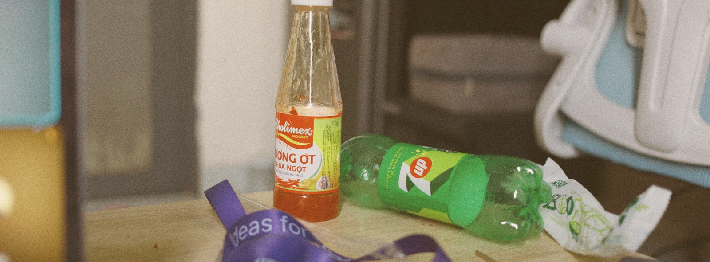

A Magic Lantern module that puts a film stock's colour into the JPEG the camera
writes, at the shutter, without developing the CR2 afterwards. 33 recipes —
negative, slide, black and white — chosen from a film shelf on the camera's own
screen, and applied to the full 5472×3648 frame before Canon's encoder turns it
into a file.

## What it does

* **The look lands in the JPEG.** The module hooks the firmware's `ssraw → YUV`
  completion (`0xFF16E930`), grades the frame Canon is about to encode in DRAM,
  and Canon's hardware encoder writes the file. No second file, no post-processing,
  no CR2 decode. This route is switched on by `film.sim.capture` +
  `film.sim.neutralcap`; see [two routes, one look](#limits--stated-plainly).
* **33 stocks** as editable `.fs` recipes: tone curve, per-hue saturation and
  rotation, split tone, halation, grain.
* **Neutral capture.** The camera is put on its built-in *Neutral* picture style
  (`PROP_PICTURE_STYLE = 0x84`), so Canon contributes no look of its own and the
  engine's is applied exactly once.
* **LiveView shows the same look** while you compose, through ML's display
  filter, and framing bars show where a crop will land.

Measured on the 6D (1.1.6), 5472×3648 frames:

| | |
|---|---|
| grade pass, full frame | 191 clock-ms through the cached alias, 817 through the uncached view |
| wall-clock cost per shot | ~2 s — the clock inside the hook counts ~10× less than wall time, see *Limits* |
| memory the module can allocate | **383 KB** (ML's malloc pool) |
| proof the look reached the file | a B&W recipe produces a JPEG with **sat 0.0** over the whole frame, while the log shows the capture style was Neutral `0x84` (not Monochrome `0x86`) |

## The film shelf

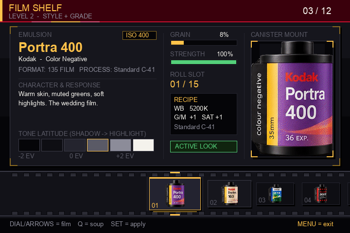

`SET` moves to the next stock, `Q` goes back, and the strip scrolls. The canister
artwork is parsed from `ML/data/FILMCAN.DAT` by the same code the host preview
uses, so what the LCD shows is what the preview renders.

The glide is a spring, not an ease — position and velocity in fixed point,
integrated in 8 ms sub-steps on the same 30 ms clock the panel repaints on, so a
late frame cannot fling the strip
([`gui/fs_spring.h`](magiclantern/modules/film_sim/gui/fs_spring.h)). The
animation below is that integrator stepped for three slots of travel, one frame
per tick, drawn by the camera's own strip drawer:

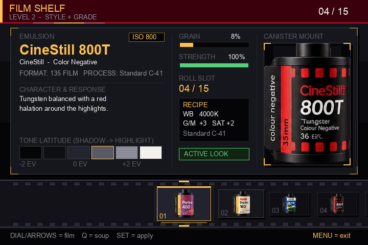

## The screens

Every camera screen in this README is drawn by the module's own drawing code
([`gui/fsg.c`](magiclantern/modules/film_sim/gui/fsg.c),
[`fsg_creator.c`](magiclantern/modules/film_sim/gui/fsg_creator.c),
[`fsg_wb.c`](magiclantern/modules/film_sim/gui/fsg_wb.c)) on the desktop, through
the same two primitives the camera uses: `fsg_fill` and `fsg_text`, implemented
with `bmp_*` on the panel and into an RGB buffer on a Mac. There is no mockup
layer, so a row in the wrong place here is a row in the wrong place on the LCD.
The one thing that is not the camera's is the glyphs — the preview sets the text
in Arial, so a line can be a few pixels wider than ML's font box; positions,
colours and every fill are the panel's. The palette is eight-bit indices — 48
fills for the wheel alone — because that is what the panel has:

```sh
# the shelf and the darkroom
gcc -O1 -Imagiclantern/modules/film_sim \
    magiclantern/modules/film_sim/tools/gui_preview/preview.c \
    magiclantern/modules/film_sim/gui/fsg.c \
    magiclantern/modules/film_sim/gui/fsg_host.c \
    magiclantern/modules/film_sim/gui/fsg_dat.c \
    -o /tmp/fsg_preview -lm
/tmp/fsg_preview tools/florin_filmroll_1.1/FilmRoll-6D-beta11/ML/data/FILMCAN.DAT

# the creator and the WB screens
gcc -O1 -Imagiclantern/modules/film_sim \
    magiclantern/modules/film_sim/tools/gui_preview/creator_preview.c \
    magiclantern/modules/film_sim/gui/fsg.c \
    magiclantern/modules/film_sim/gui/fsg_host.c \
    magiclantern/modules/film_sim/gui/fsg_dat.c \
    magiclantern/modules/film_sim/gui/fsg_creator.c \
    magiclantern/modules/film_sim/gui/fsg_wb.c \
    -o /tmp/fsg_creator -lm
/tmp/fsg_creator edited

python3 magiclantern/modules/film_sim/tools/gui_preview/render.py   # -> PNG
python3 magiclantern/modules/film_sim/tools/gui_preview/render.py \
    --gif /tmp/shelf_glide.gif $(ls /tmp/fsg_anim*.ppm | sed 's|/tmp/fsg_||;s|\.ppm||')
```

### Colour custom: twelve wedges, in the panel's own palette

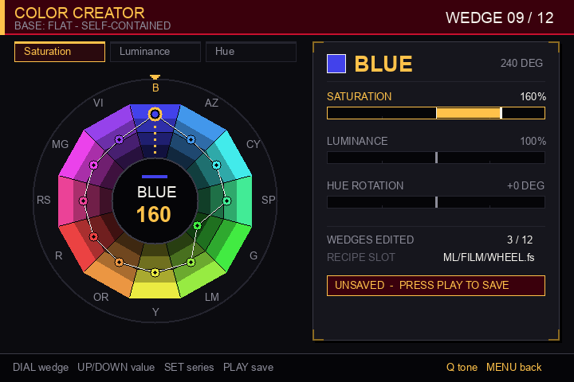

Twelve wedges, not six axes: each one carries **saturation** (0–200 %), **hue
rotation** (±180°) and **luminance** (0–200 %), so a wedge can be lifted without
moving its neighbour. The needle marks the wedge under edit and the ring runs
through every wedge's current value, which is why a saved look reads as one
shape rather than as a list of numbers. A key press moves the target and the
ring springs to it on a 30 ms clock — the panel's numbers change at once, the
wheel catches up:

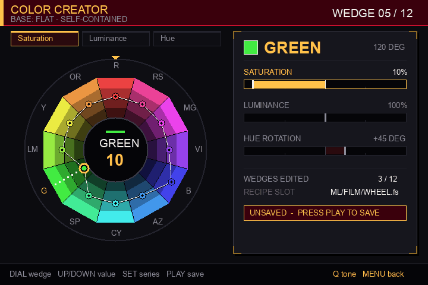

The fill is 12 wedges × 4 radial bands = 48 palette entries — the panel is
eight-bit indices, so a gradient has to be dithered by hand — and a full repaint
of this screen costs 0.74 ms on a Mac, which is why the camera only redraws the
wheel when a value moves.

A saved wheel is a **complete recipe, not a delta** — `fs_creator_write()` emits
its own curve, twelve `HUE_SAT`, twelve `HUE_ROT` and twelve `HUE_LUM` values,
with `WB AS_SHOT`, so it loads and grades exactly like a stock. It lands in
`ML/FILM/WHEEL.fs` (or `WHEEL2`..`WHEEL4` for the other three slots) and
`User Look ▸ Apply WHEEL2` makes it the active look.


### The FX and tone screens

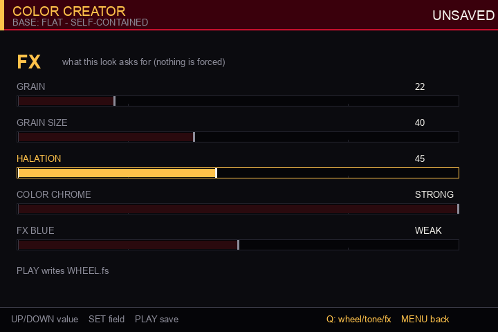

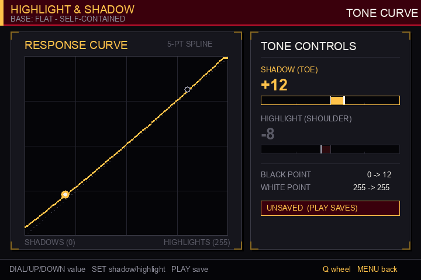

### White balance shift: pushed to the camera, then read back

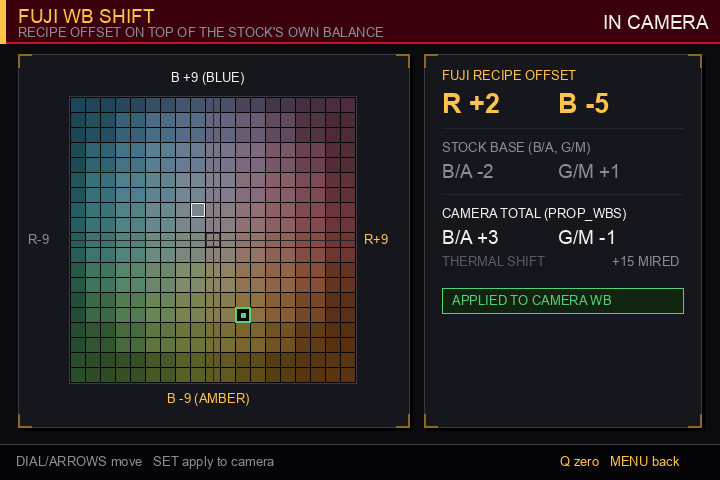

Fuji's recipe numbers are Red and Blue; Canon's are B/A and G/M. The screen shows
both, and it only turns green when the camera's own property reports the value
that was asked for — `prop_request_change()` is fire-and-forget, so "IN CAMERA"
means a read-back, not a message sent.

### The darkroom

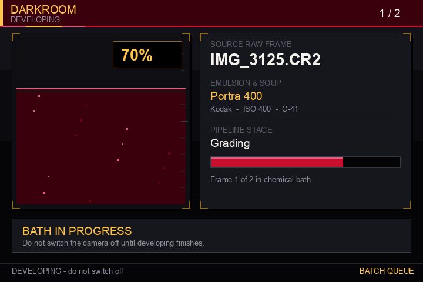

## 65:24 XPan

`Aspect ▸ 65:24 XPan` frames the panel at 2.708:1 and Develop writes a real
5472×2020 JPEG — the rows outside the window are never encoded, so the file is
smaller and the grain is right. Capture is the honest exception: Canon decides
the dimensions of the JPEG it writes, so at the shutter the framing is burned in
as bars (see [Limits](#limits--stated-plainly)).

## A Fuji recipe, field for field

A recipe on a Fuji body is not a screen — it is a bundle of I.Q. menu items saved
into a C1..C7 slot. Here that bundle is a `.fs`, and the ranges are Fuji's own:

| field | range | what it does |
|---|---|---|
| TONE CURVE highlight | −2 … +4 | compresses (−) or lifts (+) the top end |
| TONE CURVE shadow | −2 … +4 | deepens (−) or lifts (+) the bottom end |
| COLOR | −4 … +4 | saturation |
| COLOR CHROME EFFECT | off / weak / strong | deeper gradation in highly saturated colours |
| COLOR CHROME FX BLUE | off / weak / strong | the same, restricted to blue |
| GRAIN EFFECT | off / weak / strong | |
| GRAIN SIZE | small / large | |
| WB shift R / B | −9 … +9 | pushed to the camera, shown not baked into the `.fs` |

Three fields a published recipe carries are **not** offered, because they cannot
be honoured here: `DYNAMIC RANGE` (raises ISO and pulls highlights before
digitising; on an 8-bit JPEG that headroom is already gone), `CLARITY` (needs a
graded-luma ring — designed, measured, reverted) and `HIGH ISO NR` (Canon's NR
lives in the picture style and is not driven yet). A knob that does nothing is
worse than an absent row.

## Before and after

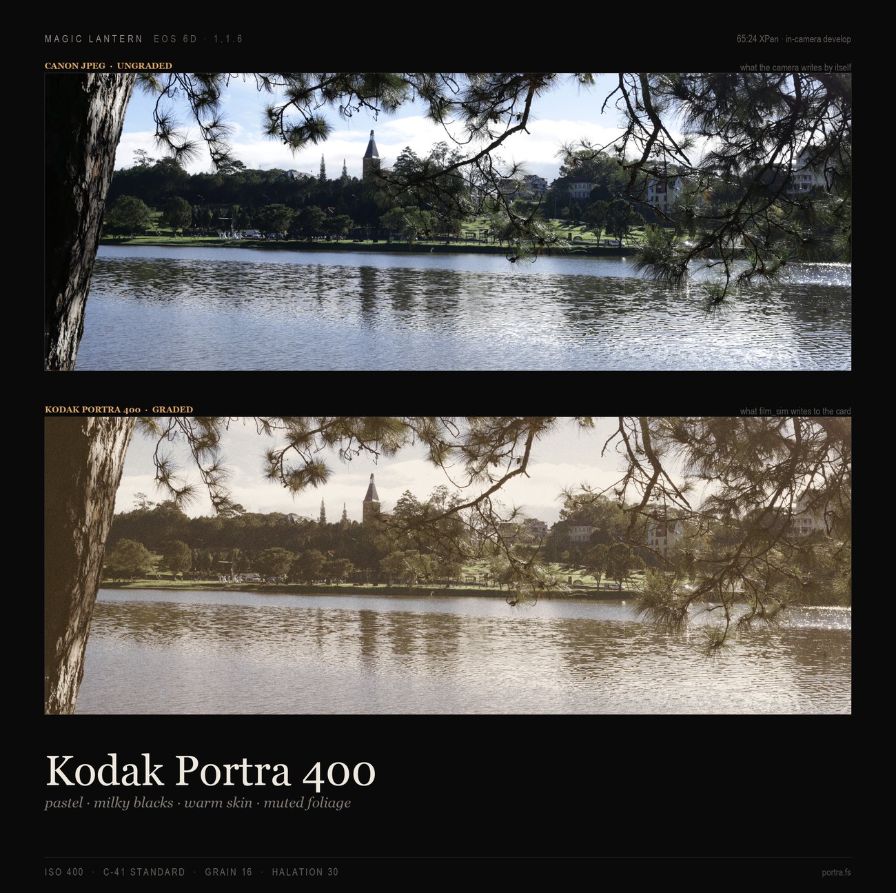

One frame (`IMG_3211.CR2`), Canon's own Neutral JPEG first and then four stocks
through the engine. Same pixels, four recipes: Portra 400 stays muted and warm,
Gold 200 pushes yellow, Velvia 50 goes deep green and orange, Ektachrome 100
stays close to the scene. Rendered by the same code the camera's Develop runs,
on the camera's own CR2 — the recipes are the shipped `.fs` files.

## Same frame, four stocks

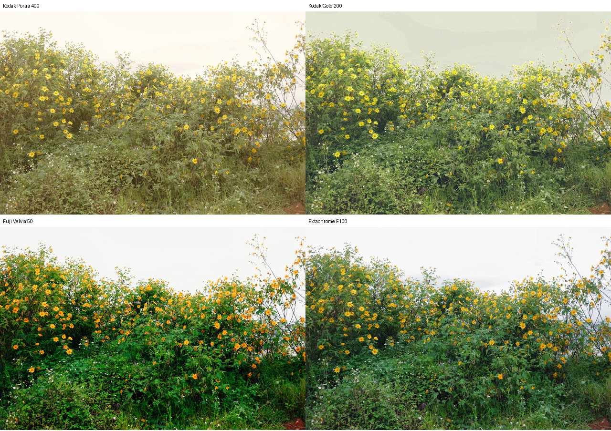

What each stock actually does differently, measured on this frame over the whole
picture (mean chroma spread / mean luma):

| stock | chroma | luma | character |
|---|---|---|---|
| Canon Neutral | 34.6 | 121.6 | the reference |
| Portra 400 | 52.1 | 140.3 | muted greens, warm skin, lifted shadows |
| Gold 200 | 48.8 | 130.3 | yellow, nostalgic mids |
| Velvia 50 | 55.8 | 101.6 | deep saturated greens, dark shadows |
| Ektachrome 100 | 41.2 | 112.0 | neutral slide film, clean highlights |

## How the look gets into the file

### 1. The capture, start to finish — and the one seam the module owns

Every stage here is Canon's. The module touches two entries in this path and
owns nothing else: one **grades** — the moment between *"the picture exists"*
and *"the picture is compressed"* — and one only **reports** the buffer it
finds, so the two can be compared.

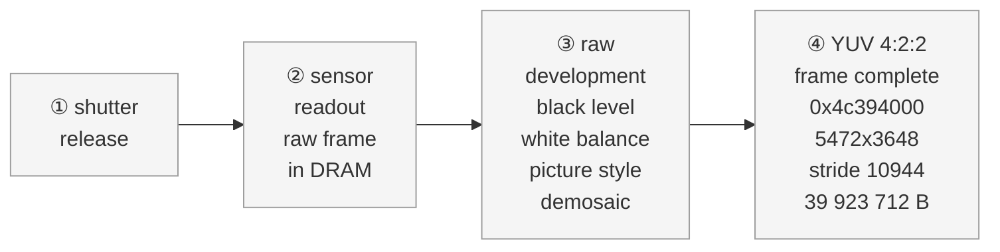

…then the seam, and Canon compressing what the seam left behind:

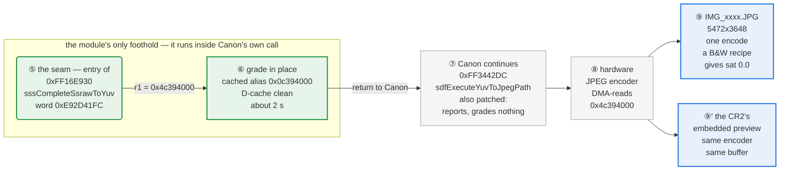

The same two rows as one image, for viewers without Mermaid, **and the
LiveView lane below them** — what ML's display filter does to every preview
frame, and what the two lanes share:
[capture pipeline](docs/img/capture-pipeline.png)
([source](docs/make_pipeline_figure.py)).

### What LiveView reuses, and what it does not

The LiveView lane is a different entry point — ML's display filter, called per
preview frame, not Canon's encoder call — but it is the same problem: grade a
UYVY frame in place before something reads it.

| | LiveView | The shot |
|---|---|---|
| entry | `CBR_DISPLAY_FILTER` → `fs_display_filter` | `0xFF16E930` `sssCompleteSsrawToYuv` |
| source | Canon's plane, 720×480, 691,200 B | 5472×3648, stride 10944 |
| coherence | whole plane copied to `fs_snap` first (11 ms) | grades Canon's own buffer in place |
| grade | `fs_core_process_rows`, tables from `fs_presets[]` | `fs_yuvlook_apply`, tables baked from the `.fs` recipe |
| cost | `lv_frame: copy=10ms grade=89ms` | about 2 s including the D-cache clean |
| shares | aspect-bar geometry (`fs_core_aspect_bars`), the signed-chroma UYVY word, the D-cache alias rule, `fs_sync()` gating | same |

The two grade engines are **not** the same look. The preview picks one of ten
presets by stock (`fs_lut_t`, 1.5 KB, no per-hue table); the shot is graded by
the recipe actually selected (`se_yuvtbl`, 3,080 B, 32×32 hue cells). On one
real LiveView frame the two disagree by **mean 36.7 levels, 83 % of samples
more than 8** — measured with `se/hosttest/bench_grade`, which also times them:

```
preview  fs_core_process_rows    0.26-0.31 ms/frame
shot     fs_yuvlook_apply+copy   0.36-0.44 ms/frame   (3 runs, this PC; use the ratio)
```

So pointing LiveView at the shot's baked tables would give an exact preview for
about 1.4× the arithmetic — not free, and the preview is already over its 33 ms
budget, so it is a real change rather than an obvious one.

Read it as two questions, because that is how it was verified:

| stage | who does it | how we know it happened |
|---|---|---|
| ①–③ exposure, readout, raw development | Canon only, never instrumented | **Not verified** individually. Inference: the frame in ④ is a finished picture, so these must have run. |
| ④ the YUV frame | Canon builds it, the module receives it | `yuvgrade: buf=0x4c394000 size=39923712, 5472x3648 stride 10944` — size and geometry are matched against the four plane sizes this body produces, not guessed |
| ⑤ the seam | **the module** | `yuv hook: still(ff3442dc)=0 ssraw(ff16e930)=0` (both patches accepted) + `yuvsites: … ssraw r0=4c394000 … diag 1` (this site, first sight of these pixels) |
| ⑥ the grade | **the module** | `yuvcost:` / `yuvcap: cache alias used …` and the in-hook clock, which counts ratios only |
| ⑦–⑧ compression | Canon does the work; ⑦'s entry is patched but only reports | The encoder is not instrumented; what is proven is its *input*, i.e. that ⑥ ran on the exact buffer ⑧ reads (same address, same size) |
| ⑨ the file | Canon writes it | The file itself: whole-frame statistics off the card — a B&W recipe comes back `R = G = B`, saturation `0.0`, **and** that run's `yuvcap` shows the capture style was Neutral `0x84`, which rules out Canon's own Monochrome style as the cause |

Three things worth knowing about this picture:

* **The seam is not a second pass over the image.** The module rewrites one
  instruction word; when Canon calls that address it lands in
  `fs_yuv_hook()` first, grades, returns, and Canon's own instructions then run
  as normal. Canon never learns it happened, and there is no re-encode.
* **The look is added after Canon's picture style, not instead of it.** That is
  why the base has to be Neutral: the style has already shaped the YUV in ③, so
  a non-neutral style plus our grade means two looks stacked.
* **The seam is armed by `film.sim.neutralcap`.** That one key does both halves
  of the job — with `film.sim.capture` on and a level above *style only*, it
  forces built-in Neutral `0x84` at capture *and* sets `fs_yuvhook_grade()` to a
  non-zero row count. With it off the hook still finds
  the buffer and still reports it, but grades 0 rows, and the look comes from
  the picture style instead (level 1). Two mechanisms, never both:
  `yuvgrade: in-shutter grade ON (capture style Neutral)` versus
  `yuvgrade: in-shutter grade off (capture style stock)` says which one a given
  build is running.

Deliberately **not** in this diagram, because neither one touches the saved
file: Magic Lantern's display filter (it grades the LiveView buffer, so the
preview on the screen carries the look and the JPEG does not) and the post-shot
develop (level 2 — it decodes the CR2's preview, grades it and encodes again, a
second generation, used when the seam is switched off).

### 2. Exactly which code is hooked

The module does not own any step of the capture. It rewrites **one instruction
word** at the entry of a Canon function, so that Canon's own call lands in the
module first and returns to Canon afterwards.

| | site 1 (the one that grades) | site 2 (present, skipped) |
|---|---|---|
| address in ROM1 | `0xFF16E930` | `0xFF3442DC` |
| Canon function | `sssCompleteSsrawToYuv` | `sdfExecuteYuvToJpegPath` |
| instruction word found there | `0xE92D41FC` — `push {r2-r8, lr}` | `0xE92D4FFF` — `push {r0-r12, lr}` |
| source | [fs_yuvhook.c](/Users/tungdl/Documents/MagicLatern/magiclantern/modules/film_sim/fs_yuvhook.c:89) | [fs_yuvhook.c](/Users/tungdl/Documents/MagicLatern/magiclantern/modules/film_sim/fs_yuvhook.c:87) |

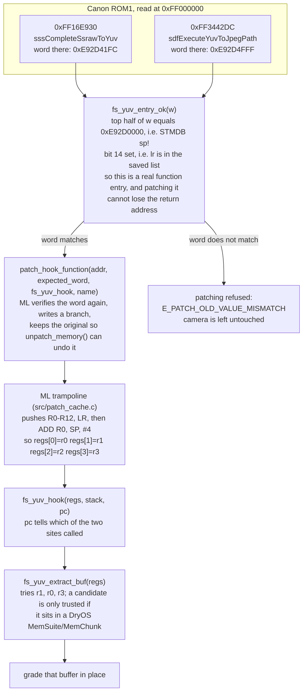

The two sites are both patched on purpose: the still path calls one or the
other depending on how the shot was made, and `diag` decides which of them
actually holds the frame. Only one of them averages a grade (`sites jpeg 0/1
ssraw 1/1`), because the second would grade the same pixels twice.

### 3. How we know the hook is really there

Five independent gates. Each one fails in a *different* line, so the presence of
the success line is evidence rather than silence.

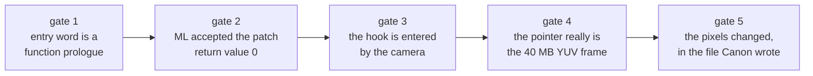

| gate | how it is checked | line in `ML/LOGS/FILMSIM.LOG` | what a failure looks like |
|---|---|---|---|
| 1. the address is a function entry | `fs_yuv_entry_ok()` — `STMDB sp!,{…}` **and** `lr` in the list | `yuv hook: still(ff3442dc)=0 ssraw(ff16e930)=0` | the `install` value is a negative error, not 0 |
| 2. ML accepted the patch | `patch_hook_function()` returns 0 per site, and the word it was given was the word it found | `… (install 0)` on the same line | `E_PATCH_OLD_VALUE_MISMATCH`, and neither site is flagged patched |
| 3. the camera enters the hook | per-site call counters incremented from inside the hook | `yuvhook: 4 call(s) (3 still, 1 ssraw)` or `sites jpeg 0/1 ssraw 1/1` | `yuvgrade: hook installed but never called after 30 s -- the …` |
| 4. the pointer is the frame | size, geometry and stride are detected and logged, not assumed | `yuvgrade: buf=0x4c394000 size=39923712, 5472x3648 stride 10944` | `nobuf` / `badsize` / `sniff 0x…` counters instead of a grade |
| 5. the file changed | the written JPEG is measured, and a B&W recipe must come out neutral **with the capture style logged as Neutral** — otherwise Canon's own Monochrome style explains it | `yuvcap: cache alias used …` plus **sat 0.0** over the whole 5472x3648 frame, in the same run as `camera style 0x84` | a colour recipe's JPEG, or one identical to the ungraded capture |

Gate 3 also names *which* site ran, from the `pc` the trampoline hands over, and
gate 4 prints the registers the pointer came from:

```
yuvsites: pq=… | jpeg r0=… r1=… diag 5 | ssraw r0=4c394000 r1=… diag 1
yuvcap:   cache alias used (bit 30 cleared, D-cache cleaned); camera style 0x84 (built-in Neutral)
```

`diag` is a fingerprint of the buffer contents, and `1` on the ssraw site means
it is the first time this frame has been seen — that is what decides "grade
now" versus "already graded, leave it alone". It was misread early on as *"the
look never reached the file"*; it only ever meant *one grade per shot*.

The end-to-end proof is in the file, not in the log: with a black-and-white
recipe graded in-shutter, the JPEG Canon writes is `R = G = B` everywhere. That
alone would not be proof — Canon has a Monochrome style (`0x86`) — so the two
must be read together: the `yuvcap` line from that run has to record the capture
style as built-in Neutral `0x84`, and only then can the look have come from the
graded buffer. That measurement was taken in an earlier session; the card was
not mounted while this section was written, so **the pairing has not been
re-checked here**. See
[YUV_FINDINGS.md](/Users/tungdl/Documents/MagicLatern/magiclantern/modules/film_sim/YUV_FINDINGS.md).

### 4. What happens inside the hook, and what it costs

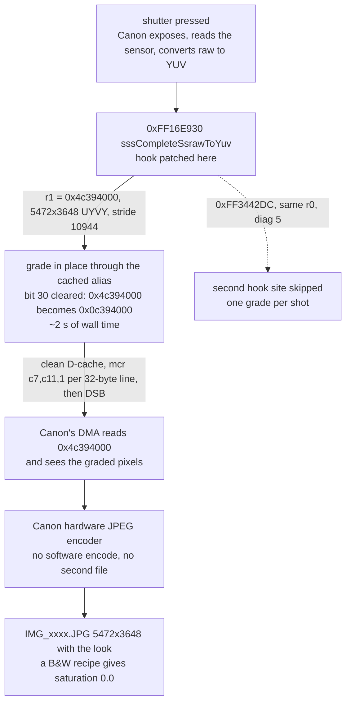

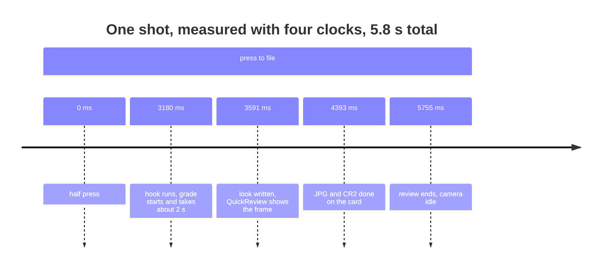

The same picture as an image, for viewers without Mermaid:
[hook path](docs/img/hook-path.png).

The buffer Canon hands over is the *uncached* view of 40 MB of RAM. Writing
through it runs at ~9.5 MB/s, which is where the original 8 s per shot came
from. Clearing bit 30 and writing the cache back once cut that to ~2 s — the
hook's own clock reports the same improvement as 817 → 191, but that clock
counts ~10× less than wall time, so only the ratio is trustworthy. `yuvcap:` in
`ML/LOGS/FILMSIM.LOG` says which path ran.

## Quick start

```sh
./build.sh 6D.116          # cross-compile ML + modules for the 6D
./install-sd.sh            # copy to the card, then verify by hash
```

On the camera: **Modules → Film Sim**. `Level` selects what the module does:

| level | meaning | state |
|---|---|---|
| 1 | look written into picture-style slots, camera bakes it | works |
| 2 | look graded into the frame at the shutter | **works — the path above** |
| 3 | raw develop (decode the sensor raw first) | in progress, mRAW not implemented |

Develop and the shelf are always explicit: **Develop ▸ Current Photo /
Darkroom / Comparison x4**. Selecting a level develops nothing.

## Verification

Every claim here is meant to be checkable from the card or from
`ML/LOGS/FILMSIM.LOG`:

```
yuvgrade: 1 shot(s) graded, buf=0x4c394000 ... 3648 rows in 191 ms;
          sites jpeg 0/1 ssraw 1/1
yuvcost: hook 5 ms at 61339 ms, worst 241 ms (grade 191 ms); malloc pool free 383 KB
yuvcap: cache alias used (bit 30 cleared, D-cache cleaned);
        camera style 0x84 (built-in Neutral); engine look is the only look expected in the JPEG
```

Host-side regression, which must keep reproducing the same hash:

```sh
cd magiclantern/modules/film_sim/se/hosttest && make
./se_cam_test <CR2> ../../films/portra.fs out.jpg    # 9f73eba4e8a993de1db014adbbe245cc
```

## Limits — stated plainly

* **Aspect ratio cannot be baked into Canon's JPEG.** The camera writes
  5472×3648 at the full sensor shape, and a module can only write pixels into
  the YUV buffer, not change the dimensions of the file. `Framing` therefore
  draws bars on LiveView and the crop is applied afterwards; Develop output is
  cropped for real.
* **Two routes, one look, and only one of them is on by default.** The stock can
  be written into the picture style (Canon applies it while it builds the YUV —
  the shipped default) or the frame can be graded in-shutter off a Neutral base
  (`film.sim.capture` + `film.sim.neutralcap`). Running both stacks two looks;
  running neither leaves Canon's own rendering. Which one a build is doing is in
  the log, not in the menu.
* **The clock inside the hook under-counts.** Halving `film.sim.yuvrows` halved
  the wall-clock wait (8 s → 4 s) while the reported time halved with it
  (817 → 408), so read those numbers as relative, not absolute.
* QEMU is not a usable test bed in this workspace; verification is on the camera
  or in `se/hosttest`.

## Repository layout

| path | what |
|---|---|
| `magiclantern/` | ML source (fork of `magiclantern_simplified`, trimmed to the 6D) — its own git repository |
| `magiclantern/modules/film_sim/` | the module: menu, shelf and darkroom GUI, hook, engine, recipes |
| `magiclantern/modules/film_sim/se/engine/` | vendored Soup Engine: CR2 parse, raw pipeline, look, JPEG codec |
| `magiclantern/modules/film_sim/se/hosttest/` | host harnesses — where changes are checked without the camera |
| `magiclantern/modules/film_lv/` | LiveView display-filter module (grades the preview plane) |
| `build.sh`, `install-sd.sh` | macOS wrappers: build, then copy and verify by hash |
| `docs/img/` | the images in this file |

The module keeps its evidence in
`magiclantern/modules/film_sim/YUV_FINDINGS.md`: every claim about the hook is a
log line or a measured pixel statistic, including the ones that turned out wrong.

## Build environment (macOS)

| component | purpose |
|---|---|
| `arm-none-eabi-gcc` 13.3.1 (Arm GNU Toolchain) | cross compiler with newlib headers |
| `python3` + `docutils` (`rst2html`) | module help strings are rendered at build time |
| GNU make, git, curl | build system |

The Homebrew `arm-none-eabi-gcc` formula ships no newlib headers and fails with
`stdint.h: No such file or directory`; use the Arm GNU Toolchain.

`build.sh` handles the macOS quirks: `ARM_BINPATH`, `READELF`
(`arm-none-eabi-readelf`), GNU-vs-BSD `stat`, and `rst2html` from the toolchain
venv.

## A custom look: recipe in, .cube out

A look is authored once, in a `.fs` recipe, and that is the source of truth:
the recipe bakes the tables the shutter path grades with, and it can also be
*exported* as a standard 3D `.cube` for anything else.

```sh
make -C magiclantern/modules/film_sim/se/hosttest fs2cube
./magiclantern/modules/film_sim/se/hosttest/fs2cube \
    magiclantern/modules/film_sim/films/OLYNAT.fs look.cube 33
python3 magiclantern/modules/film_sim/tools/cube2bin.py look.cube LOOK.BIN   # 29 KB
```

`fs2cube` runs the engine over a 33³ RGB lattice, so the cube is a render of
the recipe rather than a second description of it. `lutchk` closes the loop —
recipe against cube-plus-flat-recipe on a 17³ lattice, both through the engine:

| look | round trip |
|---|---|
| Classic Chrome (Fujifilm-style) | mean **1.82** levels, worst 17 |
| Olympus Natural (authored) | mean **3.77** levels, worst 44 |

The residual is the engine's own chroma rolloff and gamut fit being applied a
second time on the cube path; it is not the resample — a 33³ pack gives the
same numbers as 17³.

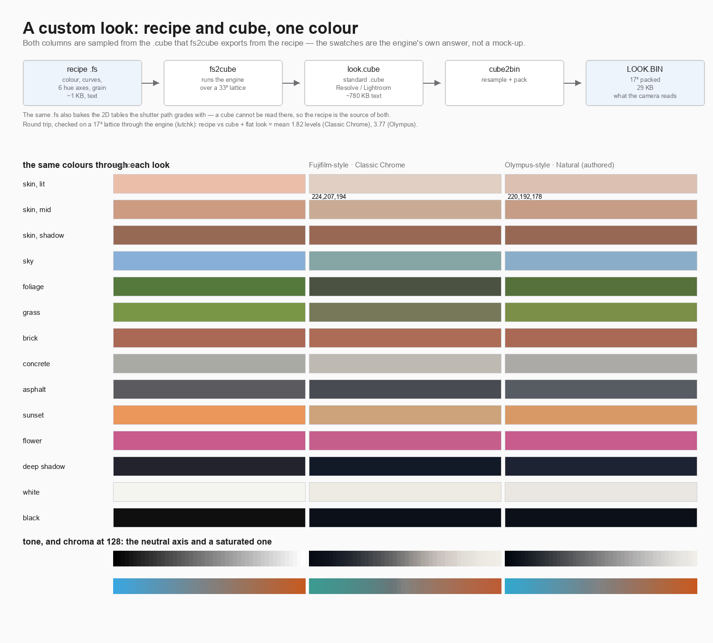

Generated by [`docs/make_look_figure.py`](docs/make_look_figure.py); every
swatch is sampled from the cube the engine exported, so nothing on that page is
invented. `films/OLYNAT.fs` is an authored look in the spirit of
Olympus/OM "Natural" — no Olympus camera was used to derive it, and the file
says so.

## External 3D LUTs in Develop

The camera cannot hold a `.cube` — `classic_neg_sRGB.cube` is 786 KB of text at
32³ and the develop's buffers already use most of what Magic Lantern can spare.
So the cube is resampled on the Mac and packed:

```sh
python3 magiclantern/modules/film_sim/tools/cube2bin.py \
    my.cube LOOK.BIN --size 17   # 29 KB
cp LOOK.BIN /Volumes/EOS_DIGITAL/ML/FILMSIM/LOOK.BIN
```

Then set **Develop ▸ External LUT** to 1. The cube is applied to the decoded
rows just before the film look, which is the sRGB input Lightroom and Resolve
export for. Set **Strength** to 0 if the cube is meant to be the look rather
than sit under it.

| size | file | mean error vs the 32³ original | max |
|---|---|---|---|
| 17³ | 29 KB | 1.17 / 255 | 30 |
| 25³ | 94 KB | 0.55 / 255 | 19 |
| 33³ | 216 KB | 0.39 / 255 | 17 |

Two converted cubes are in `luts_bin/`. The error is concentrated where the cube
is steep — that is the source data, not the converter: sampled at its own 17 grid
nodes the packed file matches the original to 0.002/255.

## 84 film stocks, and what came from M-Film

The shelf now holds **84 stocks**: the 33 tuned here, plus 51 imported from
[M-Film](https://github.com/HNGSeries/M-Film)'s catalogue. Their colour comes
from the MIT-licensed [Film-Luts](https://github.com/YahiaAngelo/Film-Luts)
collection, baked into a per-stock `ML/FILMSIM/LUT/<CODE>.BIN` and referenced
by the `<lut>` tag of the stock's XML; the stock's `.fs` carries grain and
halation only. A stock's own LUT is used whether or not **Develop ▸ External
LUT** is on — it is part of the stock, not a session option.

```sh
python3 magiclantern/modules/film_sim/tools/mfilm_import.py --list
python3 magiclantern/modules/film_sim/tools/mfilm_import.py --all-missing --out /Volumes/EOS_DIGITAL
```

[What else that repository has worth taking, and what it measures →](docs/m-film.md)
— the spring-driven shelf animation, the palette-ramp renderer, the synthetic
RAW fixture generator, the qemu instruction profiler, and their measured 6D
boot reservation of 848 KB against our 592 KB.

## Licence

GPL v2, the same licence Magic Lantern itself ships under — see
[LICENSE](LICENSE), which is a byte-identical copy of the `COPYING` file in
[`magiclantern/`](magiclantern/COPYING). The module links against ML's own code,
so it cannot carry a different licence than the thing it is built into.

Two things in the tree are other people's work, and this file is not a claim
about their terms: the canister artwork parsed from `ML/data/FILMCAN.DAT` and the
recipes derived from M-Film (both come from the FilmRoll project — see
[`docs/m-film.md`](docs/m-film.md)). Everything else under `magiclantern/` is
Magic Lantern upstream, including the prebuilt `src/libs/*.a` archives.
