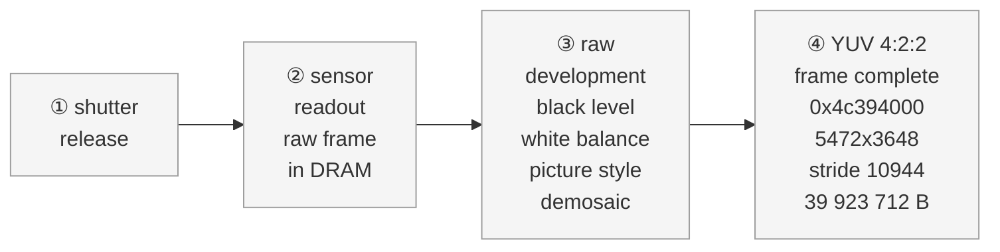
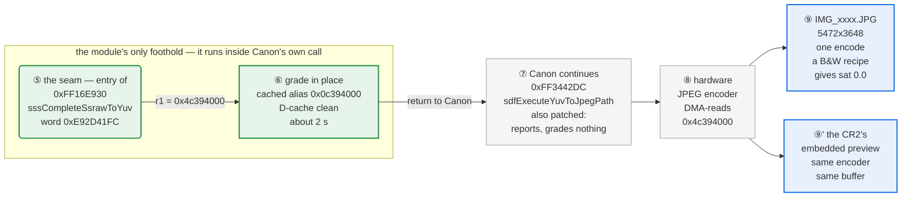
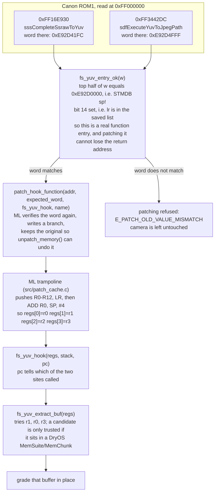
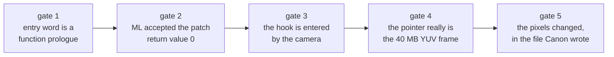
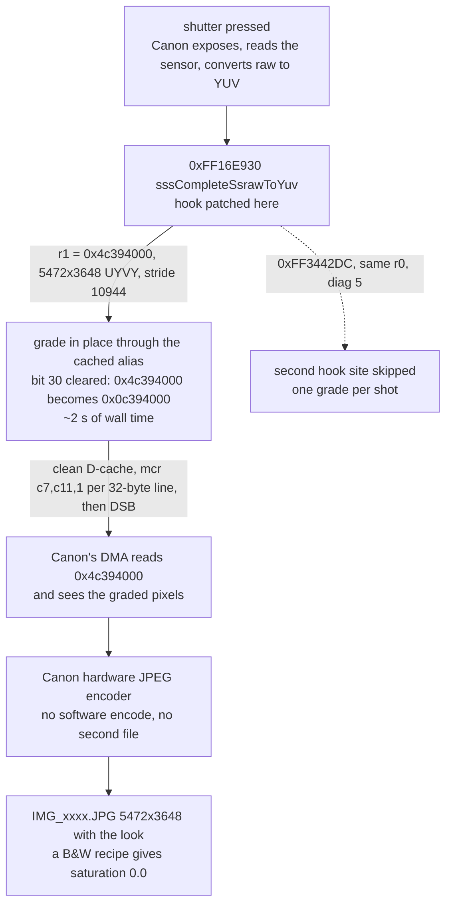
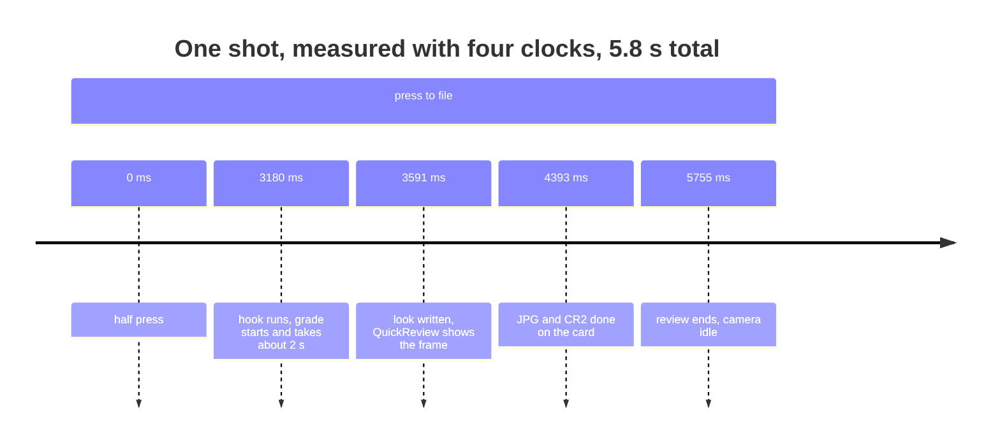

# Film Sim — Magic Lantern film stocks for the Canon EOS 6D


A Magic Lantern module that puts a film stock's colour into the JPEG the camera
writes, at the shutter, without developing the CR2 afterwards. 33 recipes —
negative, slide, black and white — chosen from a film shelf on the camera's own
screen, and applied to the full 5472×3648 frame before Canon's encoder turns it
into a file.

## What it does

* **The look lands in the JPEG.** The module hooks the firmware's `ssraw → YUV`
  completion (`0xFF16E930`), grades the frame Canon is about to encode in DRAM,
  and Canon's hardware encoder writes the file. No second file, no post-processing,
  no CR2 decode. This route is switched on by `film.sim.capture` +
  `film.sim.neutralcap`; see [two routes, one look](#limits--stated-plainly).
* **33 stocks** as editable `.fs` recipes: tone curve, per-hue saturation and
  rotation, split tone, halation, grain.
* **Neutral capture.** The camera is put on its built-in *Neutral* picture style
  (`PROP_PICTURE_STYLE = 0x84`), so Canon contributes no look of its own and the
  engine's is applied exactly once.
* **LiveView shows the same look** while you compose, through ML's display
  filter, and framing bars show where a crop will land.

Measured on the 6D (1.1.6), 5472×3648 frames:

| | |
|---|---|
| grade pass, full frame | 191 clock-ms through the cached alias, 817 through the uncached view |
| wall-clock cost per shot | ~2 s — the clock inside the hook counts ~10× less than wall time, see *Limits* |
| memory the module can allocate | **383 KB** (ML's malloc pool) |
| proof the look reached the file | a B&W recipe produces a JPEG with **sat 0.0** over the whole frame, while the log shows the capture style was Neutral `0x84` (not Monochrome `0x86`) |

## The film shelf


`SET` moves to the next stock, `Q` goes back, and the strip scrolls. The canister
artwork is parsed from `ML/data/FILMCAN.DAT` by the same code the host preview
uses, so what the LCD shows is what the preview renders.

## Before and after


Top: standard Canon Neutral JPEG capture. Bottom: the same frame with
`portra.fs` graded directly into the frame buffer at the shutter. One shot, one JPEG file, no batch work.

## Same frame, four stocks


## How the look gets into the file

### 1. The capture, start to finish — and the one seam the module owns

Every stage here is Canon's. The module touches two entries in this path and
owns nothing else: one **grades** — the moment between *"the picture exists"*
and *"the picture is compressed"* — and one only **reports** the buffer it
finds, so the two can be compared.



…then the seam, and Canon compressing what the seam left behind:



The same two rows as one image, for viewers without Mermaid:
[capture pipeline](docs/img/capture-pipeline.png).

Read it as two questions, because that is how it was verified:

| stage | who does it | how we know it happened |
|---|---|---|
| ①–③ exposure, readout, raw development | Canon only, never instrumented | **Not verified** individually. Inference: the frame in ④ is a finished picture, so these must have run. |
| ④ the YUV frame | Canon builds it, the module receives it | `yuvgrade: buf=0x4c394000 size=39923712, 5472x3648 stride 10944` — size and geometry are matched against the four plane sizes this body produces, not guessed |
| ⑤ the seam | **the module** | `yuv hook: still(ff3442dc)=0 ssraw(ff16e930)=0` (both patches accepted) + `yuvsites: … ssraw r0=4c394000 … diag 1` (this site, first sight of these pixels) |
| ⑥ the grade | **the module** | `yuvcost:` / `yuvcap: cache alias used …` and the in-hook clock, which counts ratios only |
| ⑦–⑧ compression | Canon does the work; ⑦'s entry is patched but only reports | The encoder is not instrumented; what is proven is its *input*, i.e. that ⑥ ran on the exact buffer ⑧ reads (same address, same size) |
| ⑨ the file | Canon writes it | The file itself: whole-frame statistics off the card — a B&W recipe comes back `R = G = B`, saturation `0.0`, **and** that run's `yuvcap` shows the capture style was Neutral `0x84`, which rules out Canon's own Monochrome style as the cause |

Three things worth knowing about this picture:

* **The seam is not a second pass over the image.** The module rewrites one
  instruction word; when Canon calls that address it lands in
  `fs_yuv_hook()` first, grades, returns, and Canon's own instructions then run
  as normal. Canon never learns it happened, and there is no re-encode.
* **The look is added after Canon's picture style, not instead of it.** That is
  why the base has to be Neutral: the style has already shaped the YUV in ③, so
  a non-neutral style plus our grade means two looks stacked.
* **The seam is armed by `film.sim.neutralcap`.** That one key does both halves
  of the job — with `film.sim.capture` on and a level above *style only*, it
  forces built-in Neutral `0x84` at capture *and* sets `fs_yuvhook_grade()` to a
  non-zero row count. With it off the hook still finds
  the buffer and still reports it, but grades 0 rows, and the look comes from
  the picture style instead (level 1). Two mechanisms, never both:
  `yuvgrade: in-shutter grade ON (capture style Neutral)` versus
  `yuvgrade: in-shutter grade off (capture style stock)` says which one a given
  build is running.

Deliberately **not** in this diagram, because neither one touches the saved
file: Magic Lantern's display filter (it grades the LiveView buffer, so the
preview on the screen carries the look and the JPEG does not) and the post-shot
develop (level 2 — it decodes the CR2's preview, grades it and encodes again, a
second generation, used when the seam is switched off).

### 2. Exactly which code is hooked

The module does not own any step of the capture. It rewrites **one instruction
word** at the entry of a Canon function, so that Canon's own call lands in the
module first and returns to Canon afterwards.

| | site 1 (the one that grades) | site 2 (present, skipped) |
|---|---|---|
| address in ROM1 | `0xFF16E930` | `0xFF3442DC` |
| Canon function | `sssCompleteSsrawToYuv` | `sdfExecuteYuvToJpegPath` |
| instruction word found there | `0xE92D41FC` — `push {r2-r8, lr}` | `0xE92D4FFF` — `push {r0-r12, lr}` |
| source | [fs_yuvhook.c](/Users/tungdl/Documents/MagicLatern/magiclantern/modules/film_sim/fs_yuvhook.c:89) | [fs_yuvhook.c](/Users/tungdl/Documents/MagicLatern/magiclantern/modules/film_sim/fs_yuvhook.c:87) |



The two sites are both patched on purpose: the still path calls one or the
other depending on how the shot was made, and `diag` decides which of them
actually holds the frame. Only one of them averages a grade (`sites jpeg 0/1
ssraw 1/1`), because the second would grade the same pixels twice.

### 3. How we know the hook is really there

Five independent gates. Each one fails in a *different* line, so the presence of
the success line is evidence rather than silence.



| gate | how it is checked | line in `ML/LOGS/FILMSIM.LOG` | what a failure looks like |
|---|---|---|---|
| 1. the address is a function entry | `fs_yuv_entry_ok()` — `STMDB sp!,{…}` **and** `lr` in the list | `yuv hook: still(ff3442dc)=0 ssraw(ff16e930)=0` | the `install` value is a negative error, not 0 |
| 2. ML accepted the patch | `patch_hook_function()` returns 0 per site, and the word it was given was the word it found | `… (install 0)` on the same line | `E_PATCH_OLD_VALUE_MISMATCH`, and neither site is flagged patched |
| 3. the camera enters the hook | per-site call counters incremented from inside the hook | `yuvhook: 4 call(s) (3 still, 1 ssraw)` or `sites jpeg 0/1 ssraw 1/1` | `yuvgrade: hook installed but never called after 30 s -- the …` |
| 4. the pointer is the frame | size, geometry and stride are detected and logged, not assumed | `yuvgrade: buf=0x4c394000 size=39923712, 5472x3648 stride 10944` | `nobuf` / `badsize` / `sniff 0x…` counters instead of a grade |
| 5. the file changed | the written JPEG is measured, and a B&W recipe must come out neutral **with the capture style logged as Neutral** — otherwise Canon's own Monochrome style explains it | `yuvcap: cache alias used …` plus **sat 0.0** over the whole 5472x3648 frame, in the same run as `camera style 0x84` | a colour recipe's JPEG, or one identical to the ungraded capture |

Gate 3 also names *which* site ran, from the `pc` the trampoline hands over, and
gate 4 prints the registers the pointer came from:

```
yuvsites: pq=… | jpeg r0=… r1=… diag 5 | ssraw r0=4c394000 r1=… diag 1
yuvcap:   cache alias used (bit 30 cleared, D-cache cleaned); camera style 0x84 (built-in Neutral)
```

`diag` is a fingerprint of the buffer contents, and `1` on the ssraw site means
it is the first time this frame has been seen — that is what decides "grade
now" versus "already graded, leave it alone". It was misread early on as *"the
look never reached the file"*; it only ever meant *one grade per shot*.

The end-to-end proof is in the file, not in the log: with a black-and-white
recipe graded in-shutter, the JPEG Canon writes is `R = G = B` everywhere. That
alone would not be proof — Canon has a Monochrome style (`0x86`) — so the two
must be read together: the `yuvcap` line from that run has to record the capture
style as built-in Neutral `0x84`, and only then can the look have come from the
graded buffer. That measurement was taken in an earlier session; the card was
not mounted while this section was written, so **the pairing has not been
re-checked here**. See
[YUV_FINDINGS.md](/Users/tungdl/Documents/MagicLatern/magiclantern/modules/film_sim/YUV_FINDINGS.md).

### 4. What happens inside the hook, and what it costs





The same picture as an image, for viewers without Mermaid:
[hook path](docs/img/hook-path.png).

The buffer Canon hands over is the *uncached* view of 40 MB of RAM. Writing
through it runs at ~9.5 MB/s, which is where the original 8 s per shot came
from. Clearing bit 30 and writing the cache back once cut that to ~2 s — the
hook's own clock reports the same improvement as 817 → 191, but that clock
counts ~10× less than wall time, so only the ratio is trustworthy. `yuvcap:` in
`ML/LOGS/FILMSIM.LOG` says which path ran.

## Quick start

```sh
./build.sh 6D.116          # cross-compile ML + modules for the 6D
./install-sd.sh            # copy to the card, then verify by hash
```

On the camera: **Modules → Film Sim**. `Level` selects what the module does:

| level | meaning | state |
|---|---|---|
| 1 | look written into picture-style slots, camera bakes it | works |
| 2 | look graded into the frame at the shutter | **works — the path above** |
| 3 | raw develop (decode the sensor raw first) | in progress, mRAW not implemented |

Develop and the shelf are always explicit: **Develop ▸ Current Photo /
Darkroom / Comparison x4**. Selecting a level develops nothing.

## Verification

Every claim here is meant to be checkable from the card or from
`ML/LOGS/FILMSIM.LOG`:

```
yuvgrade: 1 shot(s) graded, buf=0x4c394000 ... 3648 rows in 191 ms;
          sites jpeg 0/1 ssraw 1/1
yuvcost: hook 5 ms at 61339 ms, worst 241 ms (grade 191 ms); malloc pool free 383 KB
yuvcap: cache alias used (bit 30 cleared, D-cache cleaned);
        camera style 0x84 (built-in Neutral); engine look is the only look expected in the JPEG
```

Host-side regression, which must keep reproducing the same hash:

```sh
cd magiclantern/modules/film_sim/se/hosttest && make
./se_cam_test <CR2> ../../films/portra.fs out.jpg    # 9f73eba4e8a993de1db014adbbe245cc
```

## Limits — stated plainly

* **Aspect ratio cannot be baked into Canon's JPEG.** The camera writes
  5472×3648 at the full sensor shape, and a module can only write pixels into
  the YUV buffer, not change the dimensions of the file. `Framing` therefore
  draws bars on LiveView and the crop is applied afterwards; Develop output is
  cropped for real.
* **Two routes, one look, and only one of them is on by default.** The stock can
  be written into the picture style (Canon applies it while it builds the YUV —
  the shipped default) or the frame can be graded in-shutter off a Neutral base
  (`film.sim.capture` + `film.sim.neutralcap`). Running both stacks two looks;
  running neither leaves Canon's own rendering. Which one a build is doing is in
  the log, not in the menu.
* **The clock inside the hook under-counts.** Halving `film.sim.yuvrows` halved
  the wall-clock wait (8 s → 4 s) while the reported time halved with it
  (817 → 408), so read those numbers as relative, not absolute.
* QEMU is not a usable test bed in this workspace; verification is on the camera
  or in `se/hosttest`.

## Repository layout

| path | what |
|---|---|
| `magiclantern/` | ML source (fork of `magiclantern_simplified`, trimmed to the 6D) — its own git repository |
| `magiclantern/modules/film_sim/` | the module: menu, shelf and darkroom GUI, hook, engine, recipes |
| `magiclantern/modules/film_sim/se/engine/` | vendored Soup Engine: CR2 parse, raw pipeline, look, JPEG codec |
| `magiclantern/modules/film_sim/se/hosttest/` | host harnesses — where changes are checked without the camera |
| `magiclantern/modules/film_lv/` | LiveView display-filter module (grades the preview plane) |
| `build.sh`, `install-sd.sh` | macOS wrappers: build, then copy and verify by hash |
| `docs/img/` | the images in this file |

The module keeps its evidence in
`magiclantern/modules/film_sim/YUV_FINDINGS.md`: every claim about the hook is a
log line or a measured pixel statistic, including the ones that turned out wrong.

## Build environment (macOS)

| component | purpose |
|---|---|
| `arm-none-eabi-gcc` 13.3.1 (Arm GNU Toolchain) | cross compiler with newlib headers |
| `python3` + `docutils` (`rst2html`) | module help strings are rendered at build time |
| GNU make, git, curl | build system |

The Homebrew `arm-none-eabi-gcc` formula ships no newlib headers and fails with
`stdint.h: No such file or directory`; use the Arm GNU Toolchain.

`build.sh` handles the macOS quirks: `ARM_BINPATH`, `READELF`
(`arm-none-eabi-readelf`), GNU-vs-BSD `stat`, and `rst2html` from the toolchain
venv.
