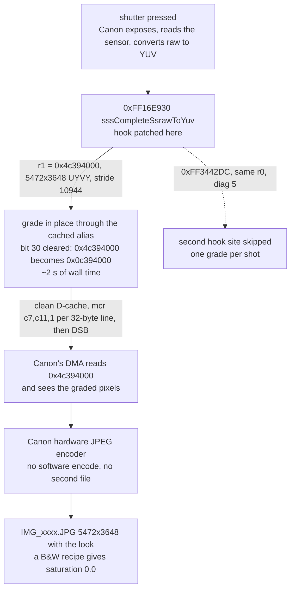
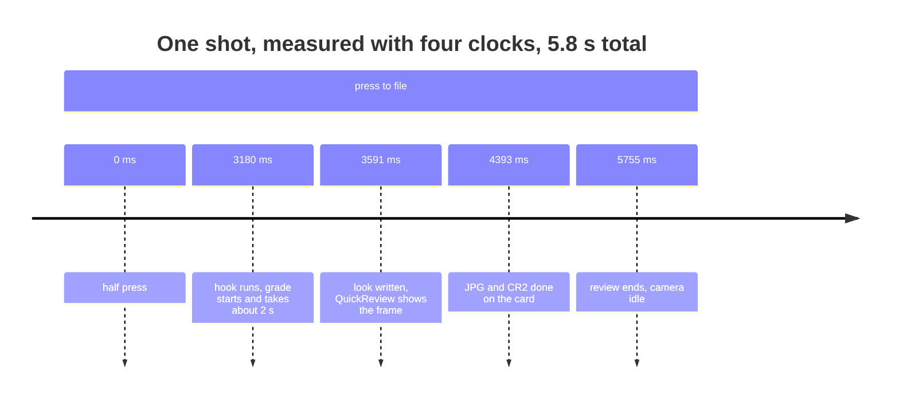

# Film Sim — Magic Lantern film stocks for the Canon EOS 6D


A Magic Lantern module that puts a film stock's colour into the JPEG the camera
writes, at the shutter, without developing the CR2 afterwards. 33 recipes —
negative, slide, black and white — chosen from a film shelf on the camera's own
screen, and applied to the full 5472×3648 frame before Canon's encoder turns it
into a file.

## What it does

* **The look lands in the JPEG.** The module hooks the firmware's `ssraw → YUV`
  completion (`0xFF16E930`), grades the frame Canon is about to encode in DRAM,
  and Canon's hardware encoder writes the file. No second file, no post-processing,
  no CR2 decode.
* **33 stocks** as editable `.fs` recipes: tone curve, per-hue saturation and
  rotation, split tone, halation, grain.
* **Neutral capture.** The camera is put on its built-in *Neutral* picture style
  (`PROP_PICTURE_STYLE = 0x84`), so Canon contributes no look of its own and the
  engine's is applied exactly once.
* **LiveView shows the same look** while you compose, through ML's display
  filter, and framing bars show where a crop will land.

Measured on the 6D (1.1.6), 5472×3648 frames:

| | |
|---|---|
| grade pass, full frame | 191 clock-ms through the cached alias, 817 through the uncached view |
| wall-clock cost per shot | ~2 s — the clock inside the hook counts ~10× less than wall time, see *Limits* |
| memory the module can allocate | **383 KB** (ML's malloc pool) |
| proof the look reached the file | a B&W recipe produces a JPEG with **sat 0.0** over the whole frame |

## The film shelf


`SET` moves to the next stock, `Q` goes back, and the strip scrolls. The canister
artwork is parsed from `ML/data/FILMCAN.DAT` by the same code the host preview
uses, so what the LCD shows is what the preview renders.

## Before and after


Top: standard Canon Neutral JPEG capture. Bottom: the same frame with
`portra.fs` graded directly into the frame buffer at the shutter. One shot, one JPEG file, no batch work.

## Same frame, four stocks


## How the look gets into the file





The same picture as an image, for viewers without Mermaid:
[hook path](docs/img/hook-path.png).

The buffer Canon hands over is the *uncached* view of 40 MB of RAM. Writing
through it runs at ~9.5 MB/s, which is where the original 8 s per shot came
from. Clearing bit 30 and writing the cache back once cut that to ~2 s — the
hook's own clock reports the same improvement as 817 → 191, but that clock
counts ~10× less than wall time, so only the ratio is trustworthy. `yuvcap:` in
`ML/LOGS/FILMSIM.LOG` says which path ran.

## Quick start

```sh
./build.sh 6D.116          # cross-compile ML + modules for the 6D
./install-sd.sh            # copy to the card, then verify by hash
```

On the camera: **Modules → Film Sim**. `Level` selects what the module does:

| level | meaning | state |
|---|---|---|
| 1 | look written into picture-style slots, camera bakes it | works |
| 2 | look graded into the frame at the shutter | **works — the path above** |
| 3 | raw develop (decode the sensor raw first) | in progress, mRAW not implemented |

Develop and the shelf are always explicit: **Develop ▸ Current Photo /
Darkroom / Comparison x4**. Selecting a level develops nothing.

## Verification

Every claim here is meant to be checkable from the card or from
`ML/LOGS/FILMSIM.LOG`:

```
yuvgrade: 1 shot(s) graded, buf=0x4c394000 ... 3648 rows in 191 ms;
          sites jpeg 0/1 ssraw 1/1
yuvcost: hook 5 ms at 61339 ms, worst 241 ms (grade 191 ms); malloc pool free 383 KB
yuvcap: cache alias used (bit 30 cleared, D-cache cleaned);
        camera style 0x84 (built-in Neutral); engine look is the only look expected in the JPEG
```

Host-side regression, which must keep reproducing the same hash:

```sh
cd magiclantern/modules/film_sim/se/hosttest && make
./se_cam_test <CR2> ../../films/portra.fs out.jpg    # 9f73eba4e8a993de1db014adbbe245cc
```

## Limits — stated plainly

* **Aspect ratio cannot be baked into Canon's JPEG.** The camera writes
  5472×3648 at the full sensor shape, and a module can only write pixels into
  the YUV buffer, not change the dimensions of the file. `Framing` therefore
  draws bars on LiveView and the crop is applied afterwards; Develop output is
  cropped for real.
* **The clock inside the hook under-counts.** Halving `film.sim.yuvrows` halved
  the wall-clock wait (8 s → 4 s) while the reported time halved with it
  (817 → 408), so read those numbers as relative, not absolute.
* QEMU is not a usable test bed in this workspace; verification is on the camera
  or in `se/hosttest`.

## Repository layout

| path | what |
|---|---|
| `magiclantern/` | ML source (fork of `magiclantern_simplified`, trimmed to the 6D) — its own git repository |
| `magiclantern/modules/film_sim/` | the module: menu, shelf and darkroom GUI, hook, engine, recipes |
| `magiclantern/modules/film_sim/se/engine/` | vendored Soup Engine: CR2 parse, raw pipeline, look, JPEG codec |
| `magiclantern/modules/film_sim/se/hosttest/` | host harnesses — where changes are checked without the camera |
| `magiclantern/modules/film_lv/` | LiveView display-filter module (grades the preview plane) |
| `build.sh`, `install-sd.sh` | macOS wrappers: build, then copy and verify by hash |
| `docs/img/` | the images in this file |

The module keeps its evidence in
`magiclantern/modules/film_sim/YUV_FINDINGS.md`: every claim about the hook is a
log line or a measured pixel statistic, including the ones that turned out wrong.

## Build environment (macOS)

| component | purpose |
|---|---|
| `arm-none-eabi-gcc` 13.3.1 (Arm GNU Toolchain) | cross compiler with newlib headers |
| `python3` + `docutils` (`rst2html`) | module help strings are rendered at build time |
| GNU make, git, curl | build system |

The Homebrew `arm-none-eabi-gcc` formula ships no newlib headers and fails with
`stdint.h: No such file or directory`; use the Arm GNU Toolchain.

`build.sh` handles the macOS quirks: `ARM_BINPATH`, `READELF`
(`arm-none-eabi-readelf`), GNU-vs-BSD `stat`, and `rst2html` from the toolchain
venv.
