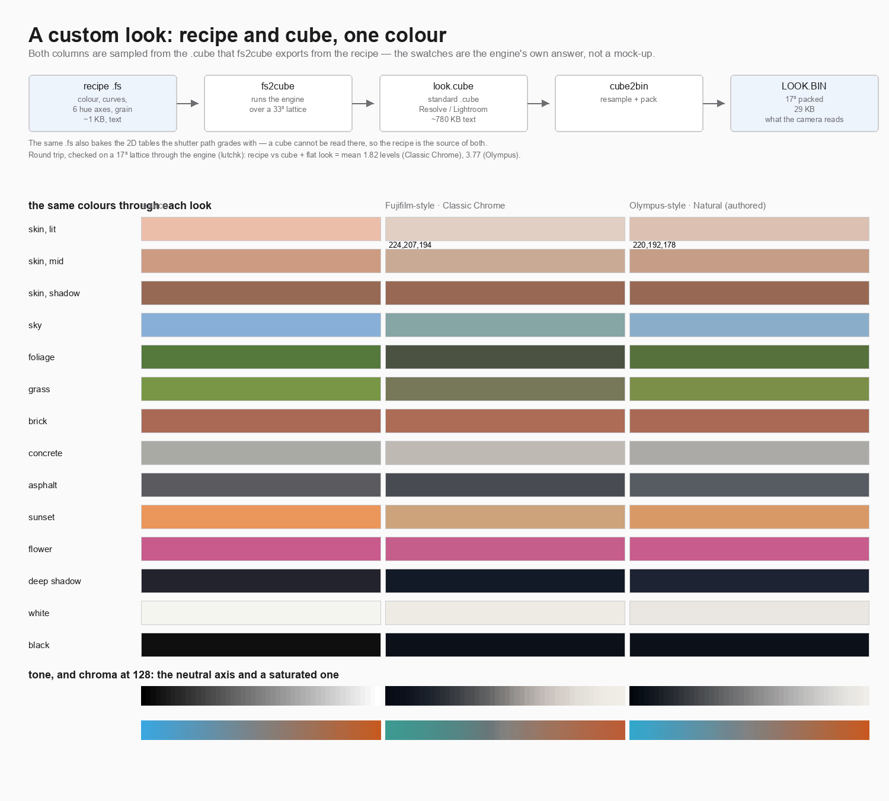

# Looks: authoring one, exporting one, importing one

Three ways to get a look that is not in the 84 already on the card.

A look is authored once, in a `.fs` recipe, and that is the source of truth:
the recipe bakes the tables the shutter path grades with, and it can also be
*exported* as a standard 3D `.cube` for anything else.

```sh
make -C magiclantern/modules/film_sim/se/hosttest fs2cube
./magiclantern/modules/film_sim/se/hosttest/fs2cube \
    magiclantern/modules/film_sim/films/OLYNAT.fs look.cube 33
python3 magiclantern/modules/film_sim/tools/cube2bin.py look.cube LOOK.BIN   # 29 KB
```

`fs2cube` runs the engine over a 33³ RGB lattice, so the cube is a render of
the recipe rather than a second description of it. `lutchk` closes the loop —
recipe against cube-plus-flat-recipe on a 17³ lattice, both through the engine:

| look | round trip |
|---|---|
| Classic Chrome (Fujifilm-style) | mean **1.82** levels, worst 17 |
| Olympus Natural (authored) | mean **3.77** levels, worst 44 |

The residual is the engine's own chroma rolloff and gamut fit being applied a
second time on the cube path; it is not the resample — a 33³ pack gives the
same numbers as 17³.



Generated by [`docs/make_look_figure.py`](make_look_figure.py); every
swatch is sampled from the cube the engine exported, so nothing on that page is
invented. `films/OLYNAT.fs` is an authored look in the spirit of
Olympus/OM "Natural" — no Olympus camera was used to derive it, and the file
says so.

## External 3D LUTs in Develop

The camera cannot hold a `.cube` — `classic_neg_sRGB.cube` is 786 KB of text at
32³ and the develop's buffers already use most of what Magic Lantern can spare.
So the cube is resampled on the Mac and packed:

```sh
python3 magiclantern/modules/film_sim/tools/cube2bin.py \
    my.cube LOOK.BIN --size 17   # 29 KB
cp LOOK.BIN /Volumes/EOS_DIGITAL/ML/FILMSIM/LOOK.BIN
```

Then set **Develop ▸ External LUT** to 1. The cube is applied to the decoded
rows just before the film look, which is the sRGB input Lightroom and Resolve
export for. Set **Strength** to 0 if the cube is meant to be the look rather
than sit under it.

| size | file | mean error vs the 32³ original | max |
|---|---|---|---|
| 17³ | 29 KB | 1.17 / 255 | 30 |
| 25³ | 94 KB | 0.55 / 255 | 19 |
| 33³ | 216 KB | 0.39 / 255 | 17 |

Two converted cubes are in `luts_bin/`. The error is concentrated where the cube
is steep — that is the source data, not the converter: sampled at its own 17 grid
nodes the packed file matches the original to 0.002/255.
